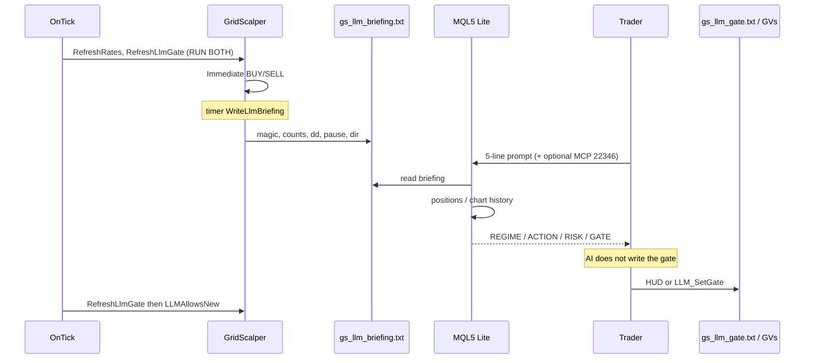
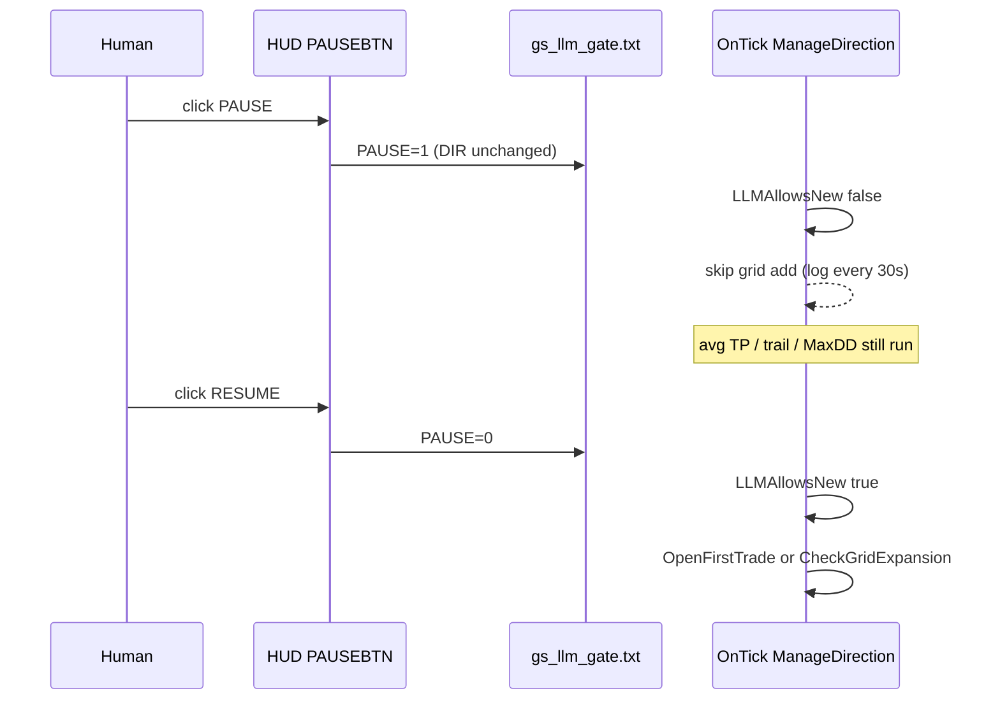
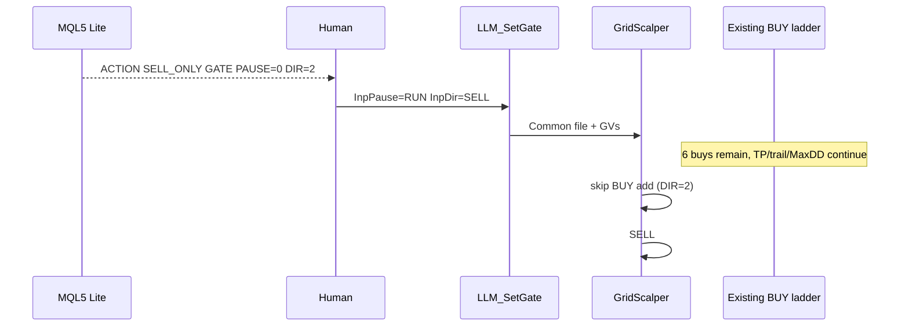

# Grid Scalper LLM coach — end-to-end explanation

This document explains how **GridScalper** (v2.21) and the native MetaTrader 5 AI Assistant work together. It is written for a trader who already builds Expert Advisors and wants the same coach-and-gate pattern on other algos.

Profit is not the success metric. Success is: the EA still executes, the model only coaches, and a human-applied pause/direction gate actually changes **new risk** without flattening the basket.

**Realtime (demo or live) is the same attach path:** compile `GridScalper.mq5`, Algo Trading ON, MQL5.community + MQL5 Lite, AI PermissionsTrade **off or confirm**, attach with a **unique magic**, paste the 5-line prompt, apply GATE via HUD or `LLM_SetGate`. Live is not a different architecture — only account, magic, and risk. Demo first.

---

## 1. One-page mental model

The Expert Advisor is the **athlete**. It still places every market order, still manages average take-profit, trailing, cooldown, and the MaxDD fuse. The native MT5 AI Assistant (MQL5 Lite) is the **coach**. It reads charts, positions, and a briefing file, then recommends a regime and a gate. The **gate** is the only handshake. The model does not write GlobalVariables, does not write `gs_llm_gate.txt`, and does not place or close trades. A human applies the recommendation by clicking the HUD or running `LLM_SetGate`. There is **no LLM, WebRequest, news, or HTTP in `OnTick`**.

```
  ticks                    timer (LLM_BriefingSeconds)
    |                              |
    v                              v
 OnTick                        OnTimer
    |                              |
 RefreshRates                  Write gs_llm_briefing.txt
 RefreshLlmGate <----+             |
 MaxDD / trail       |             v
 ManageDirection     |        AI Assistant (MQL5 Lite)
   first entry /     |          MCP 22346 (optional)
   grid add          |          5-line REGIME/ACTION/RISK/WHY/GATE
    |                |             |
    |  if LLMAllowsNew             v
    |  then SendMarketOrder    Human applies GATE
    |                          HUD click  or  LLM_SetGate
    |                                |
    |                                v
    +------ next tick ------ GS_LLM_PAUSE / GS_LLM_DIR
                             and/or Common Files gs_llm_gate.txt
```

**What success is:** judgment, not P/L. The coach can say “this Gold ladder is one-way risk, pause buys, allow sells.” The EA cannot encode news, session hostility, or “stop adding into a range” without that human-in-the-loop gate. The handshake is a pass when the 5-line header is produced, counts match the briefing, pause actually skips new `#n` comments, and exits still run.

### What we proved on demo (not theory)

These are live facts from this project’s demo, not design wishes:

- The EA still executes **all** orders. Native MT5 AI Assistant (MQL5 Lite) **only coaches**.
- Identity used: magic **999888**, comment tag **GoldScalp**, demo **111156614** on **MetaQuotes-Demo**, **hedging**.
- Gate: `GS_LLM_PAUSE` `0=RUN` `1=PAUSE`; `GS_LLM_DIR` `0=BOTH` `1=BUY` `2=SELL`. PAUSE does **not** close the basket. Average TP, trailing, and MaxDD still run.
- Live briefing path: `MQL5/Files/gs_llm_briefing.txt`.
- Gate file (live **and** visual tester): Terminal **Common Files** `gs_llm_gate.txt` (`PAUSE=` / `DIR=`). Strategy Tester does **not** share terminal GlobalVariables. That is why the HUD PAUSE button and `LLM_StartPaused` exist for tester.
- Build **6060+** is required for native AI. On Mac Wine the Windows version must report **Windows 10/11**, not Server 2008 R2 (ACP / AI stack fails otherwise). Mac **About** can still show wrapper **5834** while the Journal says **6118** — the Journal is the terminal truth.
- AI trading permission must stay **off or confirm**. The AI does **not** write the gate. The trader runs `LLM_SetGate` or clicks the HUD.
- A live 5-line reply **did** work: `REGIME range`, `ACTION SELL_ONLY`, `RISK AMBER`, `GATE PAUSE=0 DIR=2`, after MCP get-workspace / open-positions / chart-history. Position counts matched the briefing (**6 buys, 0.10 lots**).
- Pause/resume cycle **proven**: skip grid-add BUY while PAUSE; skip logs stopped when RUN; skips returned when PAUSE again; then RUN with dir=SELL.
- Do **not** overwrite `metatrader-default.md`. Copy `grid-scalper.md` into Agents. Do **not** copy `assistant.ini` between machines. Use a **unique magic** per machine/account.

### Realtime attach checklist (demo and live)

1. **OS / build:** Windows 10/11. Mac Wine guest must **not** report Server 2008 R2 (ACP / AI stack fails). Native AI needs Journal build **6060+**. Mac **About** can show wrapper **5834** while Journal shows **6118** — Journal is terminal truth.
2. Log in to **MQL5.community**. Compile `mql5/GridScalper.mq5` into Experts and `mql5/LLM_SetGate.mq5` into Scripts.
3. Copy `agents/grid-scalper.md` to `MQL5/Profiles/Agents/`. Never overwrite `metatrader-default.md`.
4. **Algo Trading ON.** AI **PermissionsTrade=0** (off) or confirm. The AI does not write the gate.
5. Attach `GridScalper` to the live chart (not the tester chart). Load `presets/Gold_Optimized.set`. Demo identity that was proven: magic **999888**, tag **GoldScalp**. On a second account or machine, pick a **different magic**.
6. Confirm Experts log `Grid Scalper v2.21 Initialized ... Gate: ON` and HUD `LLM: RUN BOTH` (or PAUSE if a leftover Common gate file exists — resume before you assume the preset).
7. **View → AI Assistant**, model **MQL5 Lite**. Prefer the 5-line prompt. Apply GATE with HUD or `LLM_SetGate`. Do not remove the EA to pause.
8. Live trading: same steps. Same handshake. Unique magic. Demo first.

If a previous `GridScalper_LLM_POC` attach still holds a gold basket, **leave that basket alone** until you intend to switch Experts. Compiling `GridScalper.mq5` as a new file does not close those tickets.

---

## 2. Components and files

| Piece | Path / name | Role |
|---|---|---|
| Expert Advisor | `mql5/GridScalper.mq5` (v2.21) | Grid athlete. RSI/MA optional. LLM gate only wraps **new** entries and **grid adds**. |
| Gate script | `mql5/LLM_SetGate.mq5` | Human applies PAUSE/DIR. Writes GVs + Common `gs_llm_gate.txt` + Common note. Does **not** place or close trades. |
| Agent profile | `agents/grid-scalper.md` → copy to `MQL5/Profiles/Agents/` | Extra coaching rules. Use **with** `metatrader-default.md`. Never overwrite the default. |
| Briefing | Live: `MQL5/Files/gs_llm_briefing.txt` | EA snapshot every `LLM_BriefingSeconds` (and once in `OnInit`). Fallback: Common Files if local write fails. |
| Gate file | Terminal Common Files `gs_llm_gate.txt` | `PAUSE=0\|1` and `DIR=0\|1\|2`. Shared by live terminal and **visual** tester. |
| Note file | Common Files `gs_llm_note.txt` | Optional string from the script (`InpNote`). Same `FILE_COMMON` as the gate. MQL5 GlobalVariables cannot store strings. |
| GlobalVariables | `GS_LLM_PAUSE`, `GS_LLM_DIR` | Numeric handshake on the **live** terminal. Tester does not see these from the live terminal. |
| HUD | Chart objects `GSP_HUD_*`, button `GSP_HUD_PAUSEBTN` | Shows `LLM: RUN\|PAUSE\|OFF` and `BOTH\|BUY\|SELL\|EA`. Click toggles pause only (keeps current DIR). |
| Demo preset | `presets/Gold_Optimized.set` | Gate **ON**, Immediate, magic 999888, tag GoldScalp, MaxDD 2000, CloseOnMaxDD true. |
| Tester preset (trades) | `presets/Gold_Optimized_Tester.set` | Gate **OFF** — proves the grid still trades. |
| Tester preset (pause) | `presets/Gold_Optimized_Tester_Paused.set` | Gate ON + `LLM_StartPaused=true` — proves zero new grid trades in **non-visual** tester. |
| Weekend live preset | `presets/BTCUSD_Live.set` | Same magic, tag `BtcScalp`, different distances. |
| Native AI | Terminal **View → AI Assistant**, model **MQL5 Lite** | Coach. 5-line header. Must not self-trade. |
| MCP (optional) | `127.0.0.1:22346` MetaTrader, `22345` MetaEditor | Workspace / positions / chart history. MetaEditor MCP dies if MetaEditor is closed. Not required for the coach handshake. |

EA identity inputs (must match the agent profile and briefing):

| Input | Demo live value | Default in source if you forget the preset |
|---|---|---|
| `StrategyTag` | `GoldScalp` | `GoldScalper` |
| `MagicNumber` | `999888` | `123456` |

If those do not match, the coach will ignore your tickets (or you will ignore someone else’s).

---

## 3. Full runtime flow

### 3.1 Startup (`OnInit`)

1. Bind `_Symbol`, `RefreshRates()`. Fail init if the symbol cannot be selected.
2. Parse `LotSequence` into `m_lot_array`. Invalid string → `INIT_PARAMETERS_INCORRECT`.
3. Create RSI on the current chart period. Optional EMA if `UseTrendFilter`.
4. `m_trade.SetExpertMagicNumber(MagicNumber)`, margin mode, 10-point deviation.
5. `EnsureLlmGlobals()` — if `GS_LLM_PAUSE` / `GS_LLM_DIR` do not exist, create them at **0**.
6. Memory defaults: `m_gate_pause = LLM_StartPaused ? 1 : 0`, `m_gate_dir = 0`.
7. `RefreshLlmGate()` — **may overwrite** those memory defaults from the Common gate file (live and visual tester) or from GlobalVariables (live, only if the file is missing). Non-visual tester does not read file or GVs, so `LLM_StartPaused` sticks.
8. If `LLM_BriefingSeconds > 0`, start `EventSetTimer`.
9. Log `Grid Scalper v2.21 Initialized. Magic: … Gate: ON|OFF`.
10. Write briefing once, draw HUD, `ChartRedraw()`.

`OnDeinit` kills the timer, releases indicators, and deletes `GSP_HUD_*` objects.

### 3.2 `OnTick` path (every quote)

1. **`RefreshRates()`** — if this fails, the tick returns immediately. No gate refresh, no orders, no HUD update on that tick.
2. **`RefreshLlmGate()`** — reload pause/dir from file/GVs according to the environment table in section 4.
3. **`CheckEquityProtection()`** — floating DD = Balance − Equity. If `> MaxDDToHedge`, set `m_dd_breached`. If `CloseOnMaxDD`, `CloseAll()`. When DD later drops back under the cap, `m_dd_breached` clears and new risk can resume (subject to gate and cooldown).
4. **`ManageDirection(BUY)` then `ManageDirection(SELL)`** — first entry or grid add, then average TP if that side has positions.
5. **`ManageTrailing()`** if `UseTrailing` — independent of the LLM gate.
6. Copy RSI buffer if calculated; **`UpdateDashboard()`**.

The LLM gate is **not** consulted for MaxDD, trailing, average TP, or basket close.

### 3.3 First entry: Immediate vs Signal

`ManageDirection` only tries a first trade when `CountPositions(type) == 0`.

Blocked before the LLM even matters:

- `m_dd_breached`
- time filter (`ApplyTimeFilter` and current time outside `StartTime`–`StopTime`)
- cooldown: `TimeCurrent() - m_last_close_time < CooldownSeconds` (armed when the **last** of our positions closes; see 3.6)

Then **`LLMAllowsNew(type)`**. If false, log at most every 30 seconds: `LLM gate: skip new BUY|SELL entry (PAUSE=… DIR=…)` and return.

Then the start mode:

- **Immediate** (`StartMode = START_IMMEDIATE`, demo preset): BUY #1 is allowed if `Trade_Direction` is BUY or BOTH. SELL #1 if SELL or BOTH. No RSI wait.
- **Signal** (`START_SIGNAL`): `CheckEntrySignal`. BUY still rejected if `Trade_Direction` is SELL-only (and vice versa). RSI: buy if RSI `< RSI_Buy_Dip` (or `< RSI_Buy_Trend` if price is above the EMA and `UseTrendFilter`). Sell if RSI `> RSI_Sell_Peak` (or `> RSI_Sell_Trend` if price is below the EMA). If RSI/MA buffers cannot be copied, there is no signal.

If a signal exists, **range filter**: `UseBuyRange` / `UseSellRange` can still veto. Then `OpenFirstTrade` — lot index 0, optional fixed SL, individual TP from `TakeProfit` points, comment `{StrategyTag} BUY|SELL #1 ({lot})`.

`UseTrendFilter` in the demo preset is **true**, but Immediate mode never calls `CheckEntrySignal`. The EMA only affects Signal mode and the briefing `ma_side=` field.

### 3.4 Grid add math

When `count > 0` and `count < MaxOrders` and not `m_dd_breached`:

1. **`LLMAllowsNew(type)`** again. If false: log `LLM gate: skip grid add …` at most every 30 seconds. **Do not** call expansion.
2. Find **worst** open price of that side: lowest BUY open, or highest SELL open.
3. Required distance = `GridDistance` points. If `current_count >= IncreaseDistAfter`, add `AddToDistance` (demo: 400, then 600 from the 4th ticket).
4. BUY add when `Ask <= worst_buy - dist * Point`. SELL add when `Bid >= worst_sell + dist * Point`.
5. Range filter on the new price.
6. Lot = `GetLotSize(current_count)` (last lot in the sequence repeats if `MaxOrders` is longer than the list).
7. If `TP_INDIVIDUAL`, set a per-ticket TP; if `TP_AVERAGE` (demo), TP on the new ticket is 0 and the basket TP is rewritten separately.
8. Comment `{StrategyTag} BUY|SELL #{count+1} ({lot})`.

`Trade_Direction` is **not** re-checked on expansion. If you attach BOTH, open sells, then change input to BUY-only without flattening, sells can still add if the LLM allows SELL. That is an EA-legacy behavior, not the gate.

Time filter and cooldown also **do not** apply to adds — only to a flat side’s first entry.

### 3.5 Basket TP / trail / MaxDD continue during pause

In the `count > 0` branch, **`UpdateAverageTP`** runs whenever `TP_Type == TP_AVERAGE`, **even if paused, even if MaxDD is breached**. It volume-weights open price and `PositionModify`s TP to `avg ± TakeProfit * Point`.

`OnTick` still calls `ManageTrailing` and `CheckEquityProtection` when paused. Pause is “stop **new** risk,” not “freeze the account.” Floating drawdown can still grow. If `CloseOnMaxDD` is true (demo preset), MaxDD **will** flatten our magic even while the HUD says PAUSE.

### 3.6 Cooldown after basket close

`OnTradeTransaction`: on a deal add for our symbol, our magic (or magic 0 if `IncludeManualTrade`), and entry OUT / INOUT / OUT_BY, if `CountMyPositions() == 0`, set `m_last_close_time` and log `Cooldown armed`. `CloseAll()` (MaxDD path) also stamps that time. Demo `CooldownSeconds = 300`. Adds on an **already open** side are not delayed by cooldown.

### 3.7 `OnTimer` briefing

Every `LLM_BriefingSeconds` (30 on Gold preset, 15 on BTCUSD preset), `WriteLlmBriefing()` overwrites the briefing file. Same writer runs once in `OnInit`.

Fields:

```
symbol=…
time=…                    (TimeCurrent)
bid=… ask=… spread_points=…
rsi=… ma_side=above_ma|below_ma|n/a
magic=… tag=…
buy_count=… buy_lots=… buy_pl=…
sell_count=… sell_lots=… sell_pl=…
dd_usd=… dd_vs_maxpct=… max_dd=…
gate_enabled=0|1 pause=OFF|RUN|PAUSE dir=EA|BOTH|BUY|SELL
balance=… equity=… free_margin=…
note=…
```

Write tries **terminal data** `MQL5/Files/` first (this is the live path that worked). If that handle is invalid, it retries with `FILE_COMMON`. Timer **can** fire when Gold is halted; bid/ask then are whatever `m_symbol` last had (often `OnInit` or the last good tick). Treat a halted briefing as **stale**.

### 3.8 How an AI session works

1. Stop Strategy Tester if you need the Lite model to answer (visual tester plus a heavy prompt is the usual “Thinking forever” case).
2. Open the **live** chart tab (not the tester chart).
3. **View → AI Assistant**. Model: **MQL5 Lite**. Trading permission: **off or confirm** (`PermissionsTrade` must not be unrestricted).
4. Prefer the 5-line prompt from `docs/LIVE-TEST-GUIDE.md` / `docs/DAY-TO-DAY.md`. Ask it to read `gs_llm_briefing.txt` only when the file exists and the tester is not starving CPU.
5. Optional MCP on **127.0.0.1:22346** (MetaTrader) for workspace, open positions, chart history. **22345** is MetaEditor — if MetaEditor is closed, that MCP is down; the terminal assistant can still chat.
6. MQL5.community must be logged in. Until then you can see **401** and Lite behaving as if the API key is missing.
7. Every trading recommendation must start with:

```
REGIME: trend-up | trend-down | range | news-risk
ACTION: RUN_BOTH | BUY_ONLY | SELL_ONLY | PAUSE_NEW_ADDS
RISK: GREEN | AMBER | RED
WHY: <one short paragraph>
GATE: PAUSE=<0|1> DIR=<0|1|2>
```

If web permission is off, news is `UNKNOWN`. The agent profile forbids inventing a calendar.

### 3.9 How a recommendation becomes action

The model **never** applies the gate. Mapping:

| ACTION | GATE to apply |
|---|---|
| `RUN_BOTH` | `PAUSE=0 DIR=0` |
| `BUY_ONLY` | `PAUSE=0 DIR=1` |
| `SELL_ONLY` | `PAUSE=0 DIR=2` |
| `PAUSE_NEW_ADDS` | `PAUSE=1` (DIR ignored while paused, but still stored) |

Human path A: run script **`LLM_SetGate`** on the same chart (Pause / Dir / optional Note). Human path B: HUD **PAUSE / RESUME** (toggles pause only; does not change DIR). Next `OnTick` → `RefreshLlmGate` → `LLMAllowsNew` on the next attempted new order.

Do not remove the EA from the chart to “pause.” That would also stop average TP, trailing, and MaxDD.

---

## 4. Gate truth table — all execution conditions

### 4.1 `LLMAllowsNew` (the only LLM predicate)

```
if UseLLMAdvisorGate == false → true
if m_gate_pause == 1          → false
if m_gate_dir == 1 and SELL   → false   // BUY-only gate
if m_gate_dir == 2 and BUY    → false   // SELL-only gate
else                          → true
```

When the gate input is off, `RefreshLlmGate` also forces memory `pause=0`, `dir=0` every tick. HUD shows `LLM: OFF EA`. HUD click is ignored.

### 4.2 Where pause/dir come from (environment)

| Environment | `UseLLMAdvisorGate` | Who wins on each tick | `LLM_StartPaused` |
|---|---|---|---|
| Live | OFF | Memory forced RUN/BOTH. File/GVs ignored. | Ignored (forced off). |
| Live | ON | **Common `gs_llm_gate.txt` if it opens.** Else live GVs. | Used only until file/GVs overwrite (typical leftover-weekend case). |
| Visual tester | OFF | Forced RUN/BOTH. | Ignored. |
| Visual tester | ON | **Common `gs_llm_gate.txt` if present.** Live GVs are **not** read. HUD click persists to that same file. | Used only if the file is missing. A leftover file from a previous visual run **overrides** `LLM_StartPaused`. |
| Non-visual tester | OFF | Forced RUN/BOTH. S3 “grid still trades” proof. | Ignored. |
| Non-visual tester | ON | **Neither file nor GVs.** Memory from `OnInit` only. | **This is the pause proof.** `Gold_Optimized_Tester_Paused.set`. |

Strategy Tester does **not** share the live terminal’s GlobalVariables. That mismatch is why an early live `LLM_SetGate` left the visual HUD on `LLM: RUN` and sells kept adding. The fix is HUD + Common file (visual) and `LLM_StartPaused` (non-visual).

### 4.3 New risk vs exits (read this table first)

Assume EA filters would otherwise allow the action (time, range, MaxOrders, distance, Immediate/Signal as noted). “Add” means that side already has `count > 0`.

| UseLLM | Pause | Dir | New BUY #1 | New SELL #1 | BUY add | SELL add | Close / avg TP / trail / MaxDD |
|---|---|---|---|---|---|---|---|
| OFF | (forced 0) | (forced 0) | Yes* | Yes* | Yes* | Yes* | Always (gate never wraps exits) |
| ON | 1 | 0/1/2 | **No** | **No** | **No** | **No** | **Always** — basket stays open |
| ON | 0 | 0 BOTH | Yes* | Yes* | Yes* | Yes* | Always |
| ON | 0 | 1 BUY | Yes* | **No** | Yes* | **No** | Always |
| ON | 0 | 2 SELL | **No** | Yes* | **No** | Yes* | Always |

\*Still subject to section 4.4–4.5. Skip logs fire only for the LLM veto, not for RSI/time/range.

### 4.4 Intersection with `Trade_Direction` and start mode

LLM DIR and EA `Trade_Direction` are **AND** for first entries.

| Trade_Direction | LLM DIR | Immediate BUY #1 | Immediate SELL #1 | Signal BUY #1 | Signal SELL #1 | Adds |
|---|---|---|---|---|---|---|
| BOTH | BOTH | Yes | Yes | If RSI/MA | If RSI/MA | If distance |
| BOTH | BUY | Yes | No (LLM) | If RSI/MA | No (LLM) | BUY yes / SELL no |
| BOTH | SELL | No (LLM) | Yes | No (LLM) | If RSI/MA | BUY no / SELL yes |
| BUY | BOTH | Yes | No (EA) | If RSI/MA | No (EA) | BUY if distance; SELL add only if SELL tickets already exist |
| BUY | BUY | Yes | No | If RSI/MA | No | Same |
| BUY | SELL | No (LLM) | No (EA) | No | No | BUY adds blocked by LLM; SELL #1 blocked by EA |
| SELL | (symmetric) | … | … | … | … | … |
| any | any + PAUSE | No | No | No | No | No |

Signal mode never opens #1 just because the gate is RUN. Immediate mode (demo) does not wait for RSI.

`count == 0` vs `count > 0`: #1 only in the flat-side branch; adds only in the open-side branch. You cannot “add” a side that does not exist, and you cannot open #1 on a side that already has tickets.

### 4.5 What still runs when new risk is blocked

| Mechanism | During PAUSE | During DIR block of that side | During MaxDD breach | Gate OFF |
|---|---|---|---|---|
| Average basket TP | Yes | Yes | Yes | Yes |
| Trailing (`UseTrailing`) | Yes | Yes | Yes | Yes |
| `CloseOnMaxDD` flatten | Yes | Yes | Yes (this **is** the flatten) | Yes |
| Broker TP/SL hits | Yes | Yes | Yes | Yes |
| Cooldown after flatten | Arms on last exit | Same | Same | Same |
| Briefing timer | Yes | Yes | Yes | Yes |
| HUD | Shows PAUSE | Shows BUY or SELL | `CRITICAL PROTECTION ACTIVE` | `LLM: OFF EA` |

### 4.6 Short prose

Think of three layers. **Layer 1** is the LLM gate: pause blocks every new ticket; dir blocks one side. **Layer 2** is the original EA: Immediate vs Signal, `Trade_Direction`, time window, cooldown, range, MaxOrders, grid distance, `m_dd_breached`. **Layer 3** is environment: live and visual tester read a **file**; non-visual tester only honors `LLM_StartPaused`; tester never sees live GVs. Exits are outside all three LLM layers. If you want “AI flatten,” this handshake does not do that — MaxDD or the trader’s fingers do.

---

## 5. Normal cases

### 5.1 Flat + Immediate + RUN BOTH

Demo preset: `StartMode=Immediate`, `Trade_Direction=BOTH`, gate ON, pause 0, dir 0, market open, cooldown expired, not in MaxDD. First tick after attach can open **both** BUY #1 and SELL #1 (hedging). That is why a Gold chart can show two #1 comments quickly. This is the athlete doing its job, not a gate bug.

### 5.2 Signal mode waits RSI/MA

Set `StartMode=Wait for RSI/MA`. Gate RUN BOTH is not enough. BUY #1 waits for RSI under the dip (or trend threshold if above EMA). Grid adds, if a side later exists, still use distance only — they do not re-check RSI.

### 5.3 Grid add when distance is hit

With an open BUY ladder, if Ask has moved `GridDistance` (then `GridDistance+AddToDistance` after `IncreaseDistAfter`) against the worst fill, and LLM allows BUY, the EA sends `#2`, `#3`, … up to `MaxOrders`. Lot follows `LotSequence`. Demo Gold sequence ends at 0.10; extra rungs repeat 0.10.

### 5.4 AI SELL_ONLY while a buy ladder exists

Proven live: six buys, 0.10 lots, briefing matched, AI returned `ACTION SELL_ONLY` / `GATE PAUSE=0 DIR=2`. Human applies DIR=2. Existing buys **stay**. Average TP / trail / MaxDD still run on buys. **No new BUY adds.** If `Trade_Direction` is BOTH, SELL #1 **may** open — a dual-grid hedge. That is the intended “stop adding into the wrong side” move, not a flatten.

### 5.5 HUD PAUSE mid-grid

Click PAUSE on the chart (works in visual tester). `ApplyGateClick` flips `m_gate_pause`, `PersistLlmGate` writes GVs **and** Common `gs_llm_gate.txt`. Next ticks skip adds (`skip grid add BUY|SELL`). Open comments stay at the current `#n`. Floating P/L still moves.

### 5.6 Resume (start back)

Click RESUME or `LLM_SetGate` Pause=RUN. Skip logs stop. When distance (or a flat Immediate signal) is valid, new `#n` comments resume. Proven cycle: PAUSE (skips) → RUN (skips stop) → PAUSE (skips return) → RUN with DIR=SELL (buys stay blocked, sells allowed).

---

## 6. Edge cases

### Gold daily halt / no ticks

`OnTick` never runs without quotes. Gate file changes sit unread until the next tick. `OnTimer` can still rewrite the briefing with a **stale** bid/ask from the last refresh. Saturday Gold on MetaQuotes-Demo is typically dead; BTCUSD was the weekend live path. Do not treat a halted briefing as a live quote.

### Tester vs live GlobalVariables mismatch

`LLM_SetGate` on the live terminal sets live GVs. A Strategy Tester EA does not see them. Visual tester must use the HUD or the Common gate file. Non-visual tester must use `LLM_StartPaused`. Mixing these is the number-one “pause is broken” report.

### Leftover PAUSE after the weekend

Live: if Common `gs_llm_gate.txt` or GVs still say `PAUSE=1` Monday morning, Immediate mode will **not** open #1 until you resume. `OnInit` sets `LLM_StartPaused` then `RefreshLlmGate` **overwrites** from file/GVs. Check HUD before you assume the preset is RUN.

### Magic mismatch (`555000` vs `999888`, or source default `123456`)

The agent profile and day-to-day prompts watch **999888** / **GoldScalp**. Attach without `Gold_Optimized.set` and you get magic **123456** and tag **GoldScalper**. Briefing will show that magic; the coach will ignore (or you will mix) tickets. Another EA using 555000 on the same account is invisible to this gate. Unique magic per machine/account.

### Heavy AI prompt + visual tester = Thinking forever

Lite + “read file + H1 vs M5 + news” while the visual tester burns CPU. Stop the tester. Use the 5-line prompt. Do not ask for the briefing on the first recovery try. The llm-agent answers in the Assistant window, not as thoughts on the tester chart.

### Mac Wine Windows 2008 / ACP

If Wine reports **Windows Server 2008 R2**, the AI/ACP stack fails. The guest OS must look like Windows 10/11. This is environmental, not an EA bug.

### LiveUpdate 5834 wrapper vs Journal 6118

Mac About can show an old **wrapper** build (5834). Journal build (6118 in the later live run; 6116 in an earlier success-criteria session) is the terminal that compiled and ran the EA. Native AI needs **6060+**. Trust the Journal.

### MQL5.community 401 until login

Lite needs a community login. Until that succeeds, the Assistant can look keyless (401). Login first; do not paste keys into chat or into this repo.

### MetaEditor MCP 22345 down if MetaEditor is closed

Port **22346** is the terminal. **22345** is MetaEditor. Closing MetaEditor drops explain-the-code MCP. Terminal coaching can continue.

### Connection timeout retcode 10012

`SendMarketOrder` always logs `retcode` and `deal`. **10012** is a trade-timeout. The gate may have allowed the order; the broker/network did not finish it. Retry is the next valid tick/distance, not an LLM rewrite. Do not interpret a timeout as “PAUSE is on.”

### Two terminals, same magic

Two Wine/Windows terminals on the **same** account with magic 999888 will both count and both try to average-TP / add / MaxDD the same tickets. Two machines must use **different magics** (and preferably different tags). Also do not copy `assistant.ini` between machines.

### AI inventing news when web permission is off

Agent rules: write `UNKNOWN`. If you see a specific CPI/FOMC claim with web off, discard that part of the answer. GATE may still be usable if charts and briefing support it.

### HUD click vs file vs script race

Last writer to Common `gs_llm_gate.txt` wins on the next live/visual tick.

- HUD toggles **pause only**, then persists **pause + current in-memory DIR**.
- Script writes **absolute** Pause and Dir (and note).
- If you HUD-click after the script but **before** the next `RefreshLlmGate`, HUD may persist a **stale DIR** and overwrite the script’s DIR.

Prefer: apply script, wait one tick, confirm HUD line. Do not click HUD and OK the script in the same second unless you intend HUD to win.

### Pause does not flatten; floating DD still grows

PAUSE only skips `OpenFirstTrade` / `CheckGridExpansion`. A six-buy ladder can keep losing. MaxDD is the fuse. If `CloseOnMaxDD=false`, even MaxDD only sets `m_dd_breached` (no new adds) without closing.

### Cooldown after basket close

After TP or MaxDD flatten, Immediate will not reopen for `CooldownSeconds` (300 Gold, 120 BTCUSD preset). That can look like a stuck gate. HUD will still show RUN. Wait, or check `m_last_close_time` via the Experts log (`Cooldown armed`).

### Visual tester leftover pause file contaminating later runs

HUD persist and `LLM_SetGate` write **Terminal Common Files** `gs_llm_gate.txt`, which live charts and the **next** visual test also read. Isolate: delete or rewrite that file, or prove pause with **non-visual** `LLM_StartPaused` (`Gold_Optimized_Tester_Paused.set`). S3-style “does the grid trade?” runs should keep **`UseLLMAdvisorGate=false`** so a leftover file cannot veto deals.

### Note file (fixed)

`LLM_SetGate` and EA `ReadLlmNote()` both use **Common Files** `gs_llm_note.txt` (same flag as `gs_llm_gate.txt`). Briefing `note=` is filled when the script wrote a note. If two EAs share one terminal, fork this filename along with the gate file.

### `RefreshRates` failure

A failed refresh aborts the whole tick, including gate reload and HUD. Rare, but a gate change then waits for a later good tick (timer briefing can still be stale).

### Time filter vs adds

`ApplyTimeFilter` blocks **first** entries only. A ladder opened at 19:59 can still add after `StopTime`. The LLM pause is the way to stop adds overnight if you do not want that.

---

## 7. Sequence diagrams

### 7.1 Happy path — live coach



### 7.2 Pause then resume



### 7.3 AI recommends DIR=2, human applies



### 7.4 MaxDD while paused

```mermaid
sequenceDiagram
  participant Tick as OnTick
  participant EA as CheckEquityProtection
  participant Gate as Pause still 1
  participant Acc as Account equity

  Tick->>EA: DD = Balance - Equity
  Acc-->>EA: DD > MaxDDToHedge (2000 demo)
  EA->>EA: m_dd_breached = true
  alt CloseOnMaxDD true (demo preset)
    EA->>EA: CloseAll our magic
    EA->>EA: Cooldown armed
  else CloseOnMaxDD false
    EA->>EA: no new adds (already paused anyway)
    Note over Gate: pause did not flatten; DD still grew until this fuse
  end
  Note over EA: UpdateAverageTP would still run if tickets remain
```

---

## 8. Porting to other existing algos

This section is the reusable pattern. Copy the **handshake**, not the Gold grid.

### 8.1 What to copy vs what not to copy

| Copy | Do not copy |
|---|---|
| Gate idea: pause + optional direction, applied only to **new risk** | Lot sequence, GridDistance, Gold RSI zones, MaxDD dollars |
| Inputs `UseLLMAdvisorGate`, `LLM_StartPaused`, `LLM_BriefingSeconds` | Putting LLM, WebRequest, or news in `OnTick` |
| `EnsureLlmGlobals`, `PersistLlmGate`, `RefreshLlmGate`, `LLMAllowsNew`, HUD toggle, `WriteLlmBriefing` | Overwriting `metatrader-default.md` |
| Wrap **new entries / scale-ins / grid adds** (that algo’s “new risk”) | Wrapping exits, trailing, SL, MaxDD, basket close |
| A **new** agent markdown named for that strategy | `assistant.ini` between machines |
| Unique `MagicNumber` + comment prefix | Reusing 999888 on a second chart/account/machine |
| Tester preset: gate OFF to prove the original algo still trades | Assuming tester sees live GVs |
| Live preset: gate ON | Letting AI trading permission run unrestricted |

`LLM_SetGate.mq5` can be reused **as-is** only if this EA is the only consumer of `GS_LLM_PAUSE` / `GS_LLM_DIR` / `gs_llm_gate.txt`. If two EAs run on one account or one terminal, **fork the GV names and filenames** or they will pause each other.

### 8.2 Minimum invasive patch

1. Do **not** call an LLM, `WebRequest`, or news API from `OnTick`. The coach lives in the Assistant process. The EA only reads two numbers.
2. Add the three inputs. Keep defaults: gate ON for the live preset; `LLM_StartPaused=false` live; briefing 15–30 seconds.
3. Copy the `#define`s for GV names and `FILE_LLM_GATE` / briefing name — **rename them** if another EA already uses `GS_LLM_*`.
4. Copy `EnsureLlmGlobals`, `PersistLlmGate`, `RefreshLlmGate` (keep the tester/visual/live file vs GV split — that bug will recur on every port if you “simplify” to GVs only), `LLMAllowsNew`, `ApplyGateClick`, labels, `WriteLlmBriefing`.
5. In `OnInit`: `EnsureLlmGlobals()`; set memory from `LLM_StartPaused`; `RefreshLlmGate()`; start timer; write briefing once.
6. In `OnTick`, call `RefreshLlmGate()` **once** after a successful price refresh, before order logic.
7. Wrap **only** the functions that increase risk: first market/pending entry, scale-in, grid add, martingale add, “recovery” add. Pattern:

```text
if(!LLMAllowsNew(type)) { log skip; return; }
// original send/order code
```

8. **Never** wrap: `PositionModify` TP/SL, trailing, `PositionClose`, basket close, `CloseOnMaxDD`, hedge-to-reduce if that is an exit in your design.
9. Give the strategy a unique magic and comment prefix. Put both in the briefing and in the agent markdown.
10. Author `agents/{their-strategy}.md`: identity, briefing path, GV names, what the model may recommend, what it must never do. Copy it to `MQL5/Profiles/Agents/`. Do not overwrite `metatrader-default.md`.
11. Either reuse `LLM_SetGate` (same GVs) or fork a `{Their}_SetGate` with new `#define`s.
12. Presets: **gate ON** for live coaching; **gate OFF** for “does the old algo still trade?” tester proof; **gate ON + `LLM_StartPaused`** for non-visual pause proof. Visual tester: HUD, not live GVs.
13. Keep AI trading permission off/confirm. The human applies GATE.

### 8.3 What to change in “their” strategy vs keep identical

Keep identical: file-vs-GV refresh rules, “exits ignore the gate,” no network in `OnTick`, 5-line header, human applies GATE, unique magic, agent file as an extra profile.

Change: briefing fields (trend-follow might send ADX and last signal time instead of buy_count/sell_count), DIR semantics (a long-only algo may only need PAUSE), HUD (optional if you only use the script), MaxDD dollars, symbol, prompts.

### 8.4 Two EAs on one account

Must use distinct:

- `MagicNumber` and comment prefix
- GV names (`GS_LLM_PAUSE` vs `PX_LLM_PAUSE`, …)
- `gs_llm_gate.txt` vs `px_llm_gate.txt`
- briefing filenames
- HUD object prefixes (`GSP_HUD_` vs something else)

Otherwise one HUD click pauses both, and one briefing overwrites the other.

### 8.5 Testing checklist when adding to another algo

1. Compile 0 errors. No license checks.
2. Tester, gate **OFF**: deal count similar to the unmodified EA on the same dates (sanity that you did not wrap exits).
3. Tester non-visual, gate ON, `LLM_StartPaused=true`: **zero** (or near-zero) **new** entries. Existing historical simulation of exits still allowed if the test starts in a position (most tests start flat).
4. Visual tester: HUD PAUSE freezes **new** `#n` / new tickets; trailing/TP still fire if your algo has them.
5. Live demo: briefing written; HUD matches file; AI 5-line header; counts match briefing; AI does not open magic-0 deals.
6. Pause does not close the working set. Resume restores new risk.
7. Leftover Common gate file: after a visual test, confirm live HUD. Reset file if needed.
8. Confirm MCP 22345 is not required for the live coach; 22346 optional.

---

## 9. Documentation template (per algo)

Copy this block into that strategy’s repo. Fill every `« »`.

```text
# «Strategy name» — LLM coach handshake

## Identity
- EA file: «….mq5»
- Magic: «unique per machine/account»
- Comment / tag: «…»
- Symbol / TF: «…»
- Account type expected: demo first, hedging/netting: «…»

## Handshake
- Briefing file: «MQL5/Files/….txt»
- Gate file: «Common Files/….txt»  (PAUSE= / DIR=)
- GlobalVariables: «NAME_PAUSE» 0=RUN 1=PAUSE; «NAME_DIR» 0=BOTH 1=BUY 2=SELL
- Set-gate script: «….mq5»
- Agent profile: «MQL5/Profiles/Agents/….md» (do not overwrite metatrader-default.md)

## What the EA still does
- New risk: «entries / adds / …»
- Always: «exits, trail, SL, MaxDD, …»

## What the LLM may do
- Recommend REGIME / ACTION / RISK / GATE
- Read briefing, chart, positions for this magic only

## What the LLM must never do
- Place/close/modify tickets
- Disable MaxDD / SL
- Invent news if web is off (UNKNOWN)
- Manage other magics
- Auto-write the gate (human applies)

## Gate mapping
- RUN_BOTH     → PAUSE=0 DIR=0
- BUY_ONLY     → PAUSE=0 DIR=1
- SELL_ONLY    → PAUSE=0 DIR=2
- PAUSE_NEW_ADDS → PAUSE=1

## Prompts
- Session open: «…»
- Risk review: «…»
- Explain-only (MetaEditor): «do not patch files»

## Pass / fail (judgment, not profit)
- [ ] Tester gate OFF still trades
- [ ] Tester LLM_StartPaused opens no new risk
- [ ] Visual HUD PAUSE freezes new tickets
- [ ] Live briefing exists and matches AI counts
- [ ] 5-line header produced
- [ ] AI trade permission off/confirm; no surprise magic-0
- [ ] Pause did not flatten; MaxDD still able to flatten
```

---

## 10. Pros and cons

**Pros**

- Extra **judgment** the grid cannot encode: news-risk, one-way Gold, hostile spread, “stop adding, do not flatten.”
- The athlete stays deterministic and backtestable (gate OFF or `LLM_StartPaused`).
- Pause is reversible. Average TP, trailing, and MaxDD keep running.
- Native Lite inside MT5 — no Cursor key inside the terminal, no `WebRequest` in the hot path.
- The same handshake can be copied onto other EAs with a small wrap around “new risk.”

**Cons (extra failure modes — these are real)**

- Leftover PAUSE in Common file or GVs after a weekend or a visual test.
- Tester vs live GV split; people will apply the script to the wrong process.
- Wine OS version, ACP, About-wrapper vs Journal build confusion.
- Lite quota / 401 until community login / “Thinking forever” under tester load.
- Human in the loop: the model **does not auto-apply GATE**. A correct recommendation with no click does nothing.
- Dual-grid surprise: `SELL_ONLY` does not close buys; it may **open** sells.
- Pause does not cap floating DD; only MaxDD (if armed) does.
- Two EAs sharing GVs/files fight.
- No profit guarantee. A coach can be wrong. Success criteria in this repo explicitly exclude beating the original EA on P/L.
- Optional MCP ports, MetaEditor lifecycle, and `assistant.ini` are more moving parts than a standalone EA.

---

## 11. Do / don’t

**Do**

- Demo first (proven: MetaQuotes-Demo **111156614**, hedging).
- Keep Algo Trading ON for the EA; keep AI **PermissionsTrade=0** (off) or confirm.
- Copy `grid-scalper.md` (or your fork) into `MQL5/Profiles/Agents/`.
- Use unique magics per machine/account; match tag, briefing, and agent profile.
- Apply GATE with HUD or `LLM_SetGate`; confirm the HUD line on the next tick.
- Prove the original algo with gate OFF in tester before you trust live coaching.
- Trust Journal build ≥ 6060, not the Mac About wrapper.

**Don’t**

- Don’t copy `assistant.ini` between machines.
- Don’t overwrite `metatrader-default.md`.
- Don’t put LLM/WebRequest/news in `OnTick`.
- Don’t wrap exits, trailing, SL, or MaxDD with `LLMAllowsNew`.
- Don’t leave unrestricted AI trading on.
- Don’t reuse magic 999888 on a second terminal.
- Don’t assume Strategy Tester reads live GlobalVariables.
- Don’t treat pause as a flatten, or a 5-line header as a profit forecast.

---

## Related files

- Day-to-day prompts: [`DAY-TO-DAY.md`](DAY-TO-DAY.md)
- Why pause looked broken / live click-through: [`LIVE-TEST-GUIDE.md`](LIVE-TEST-GUIDE.md)
- Pass/fail IDs: [`SUCCESS-CRITERIA.md`](SUCCESS-CRITERIA.md)
- Wine install paths: [`TEST-PROTOCOL.md`](TEST-PROTOCOL.md)
